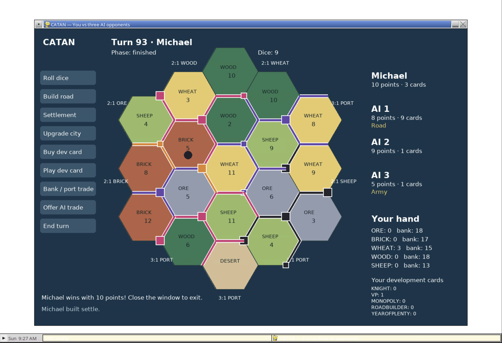

# Catan AI

A Python/Pygame Catan game with **one human and three heuristic AI opponents**.
The default target is 10 points. You go first, then AI 1, AI 2, and AI 3;
initial placements use snake order. Everyone starts under the same rules.

This project currently provides a rule engine and heuristic baseline. It does
not contain a trained Catan model, reinforcement-learning trainer, or MCTS.
The TensorFlow script and notebook are optional MNIST tutorials, unrelated to gameplay.



*An actual game played through noVNC, ending with Michael on 10 points.*

## Get the code

For a new checkout:

```sh
git clone --branch codex/catan-gameplay-fixes https://github.com/michaelyunzheng/agent-arena.git
cd agent-arena
```

For an existing checkout, switch to `codex/catan-gameplay-fixes` and run
`git pull --ff-only` from the repository root. The gameplay changes are currently
on that branch. Choose one installation route below.

## Play in a VS Code container / browser

Use the included dev container and forward port **6080** to view the Pygame desktop
through noVNC. No local Python installation is required. See
[container setup and launch instructions](CONTAINER.md), including how to use an
existing parent-workspace container.

## Install and play

Use **Python 3.12** for a new installation. Python 3.9, 3.11 and 3.12 are
covered by CI; Python 3.14 is not supported by this installation setup.
You need a graphical desktop for local play. A terminal-only container needs
the noVNC route above.

On macOS or Linux, from the repository root:

```sh
cd Catan-AI
python3.12 -m venv .venv
source .venv/bin/activate
python -m pip install --only-binary=numpy,pygame -r requirements.txt
python code/catanGame.py --name Michael
```

On Windows (PowerShell), from the repository root:

```powershell
cd Catan-AI
py -3.12 -m venv .venv
.\.venv\Scripts\python.exe -m pip install --only-binary=numpy,pygame -r requirements.txt
.\.venv\Scripts\python.exe code/catanGame.py --name Michael
```

The game opens a separate window with you and three AI opponents. Click a
highlighted intersection to place your first settlement, then a highlighted road.
If `python3.12` or `py -3.12` is unavailable, install Python 3.12 first.
The binary-only install avoids an unexpected SDL source build; “No matching
distribution” means your interpreter/platform needs a supported wheel.
Do not install `pygame` and `pygame-ce` together in this environment: they share
the same import name. The dedicated environment above uses `pygame`.

An exact set of tested direct runtime dependencies is in `requirements-lock.txt`;
substitute that file for `requirements.txt` if you need those versions.
TensorFlow and Matplotlib are not required to play.

Optional arguments:

```sh
python code/catanGame.py --name Michael --seed 42 --ai-delay 350
```

`--seed` reproduces the board and random decisions for the same sequence of actions
and dependency versions. `--ai-delay` is milliseconds between AI decisions.

## Controls

Everything is selected inside the window; no terminal prompts are needed.

- Click highlighted intersections and roads for your two starting placements.
- Roll dice, then build, buy a development card, trade, or end your turn.
- You may play one eligible development card before or after rolling. Cards bought
  this turn become playable on your next turn; victory points apply immediately.
- On a seven, select exactly the requested number of cards to discard, then move
  the robber and choose an eligible opponent. Opponents with empty hands and yourself
  are excluded. You can move to a hex with no victim.
- Bank/port trading uses your best available ratio. Player trades are offers to an
  AI, which may accept or decline; you cannot take its cards unilaterally.
- Escape cancels optional choices. Setup, discards, robber movement, and free-road
  placements must be completed. Closing the window works in all dialogs.
- The right panel shows your resources, the bank, and public opponent information.
  Your point total includes private victory-point cards; AI point totals hide those cards until the game finishes.

## Engine and simulations

`engine.py` owns phases, costs, bank supply, legal actions, development cards,
scoring, awards, and victory. Both interfaces use it. `player.py` contains state
and longest-road traversal; `board.py` provides topology and placement candidates.
`heuristicAIPlayer.py` selects actions and uses all action-card types.

Run bounded AI matches without opening a window:

```sh
python code/AIGame.py --seed 0 --games 20 --players 4 --max-turns 2000
```

Each line is JSON with seed, winner, turns (individual player turns, not rounds),
points, decision count, and completion/turn-limit status. Invariant checks run after
each decision. A turn limit is reported as truncation, not a win.

The engine exposes `build`, `roll`, `discard`, `move_robber`, `buy_dev`, `play_dev`,
`trade_bank`, `trade_players`, and `end_turn`. Invalid legal-domain actions raise
`RuleError` before mutating state. Clients must not directly edit public state
containers or call low-level board mutators. A trusted controller must obtain the
recipient's acceptance before passing `accepted=True` to `trade_players`.

`modelState(game, observer)` encodes 54 vertices, 72 edges, board tiles/ports,
own resources/cards, public points, opponent card counts, bank, and phase. It does
not expose opponents' private card types. This is an observation helper, not a full
RL API: action indexing, rewards, training, and evaluation remain future work.

## Rules covered and current limitations

The game uses a 19-card bank for each resource, 25 development cards including
14 knights, standard piece counts, second-settlement starting resources, seven
roll discards, finite-bank production shortages, port ratios, free Road Building,
Monopoly, Year of Plenty, Largest Army, and Longest Road. Road awards are recalculated
when settlements interrupt networks; ties preserve an eligible incumbent.
The standard combined trade/build phase is used after rolling.

The AI is a baseline: productive setup, greedy building, goal-directed bank trades,
card use, and simple offer acceptance. It does not initiate player-trade proposals,
negotiate counteroffers, learn, or search ahead. There is no save/load, undo, multiplayer
networking, or expansion support. The engine has regression coverage and seeded
simulation checks, but is not claimed to be a formally verified complete ruleset.

## Tests

```sh
python -m pip install -r requirements-dev.txt
python -m pytest tests -q
```

Tests use SDL's dummy video/audio drivers and cover rules, invalid-action atomicity,
the review's 13-edge longest-road regression, seeds, full matches, and GUI events.
There are no import-time games, graphical initialization, or training runs.

## Credits

Original project and MIT license attribution are retained. Hex-coordinate math in
`hexLib.py` is adapted from [Red Blob Games](https://www.redblobgames.com/grids/hexagons/).
See the [official CATAN rules](https://www.catan.com/understand-catan/game-rules)
for the board game's rules.
